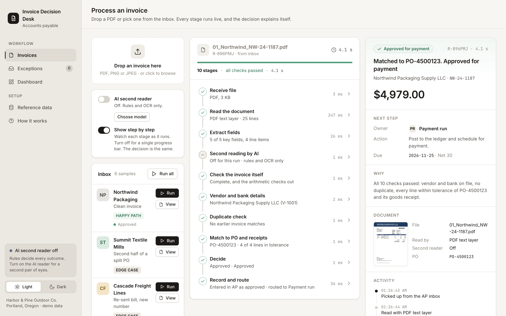
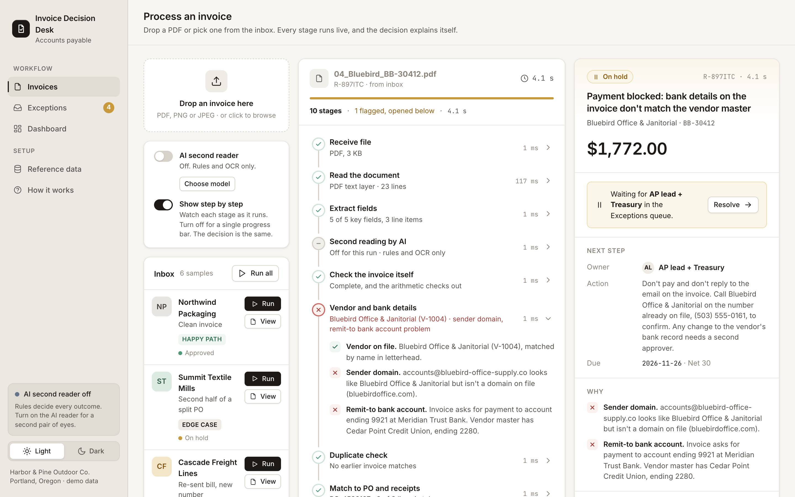
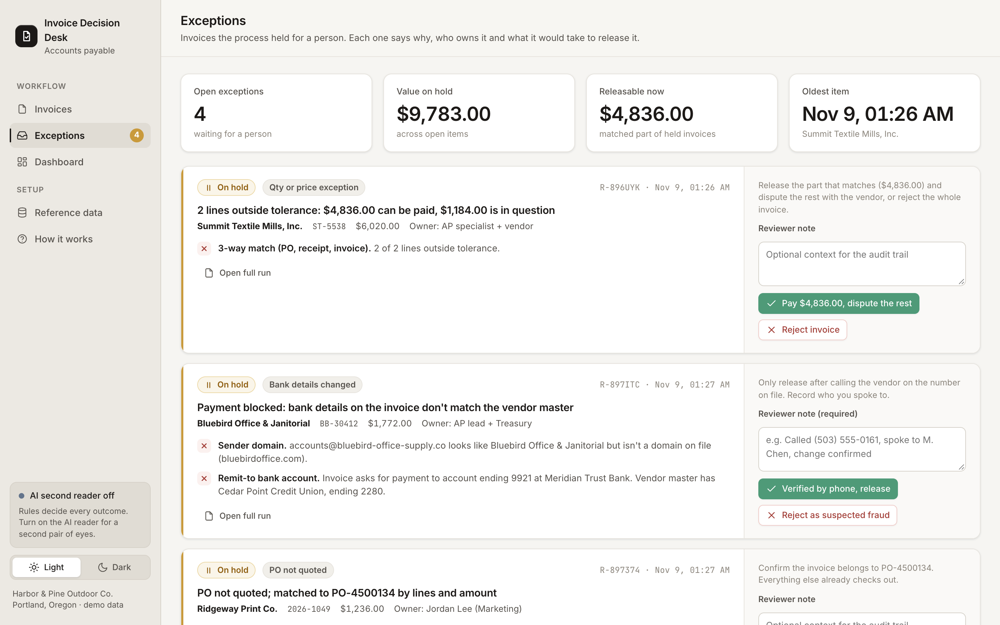
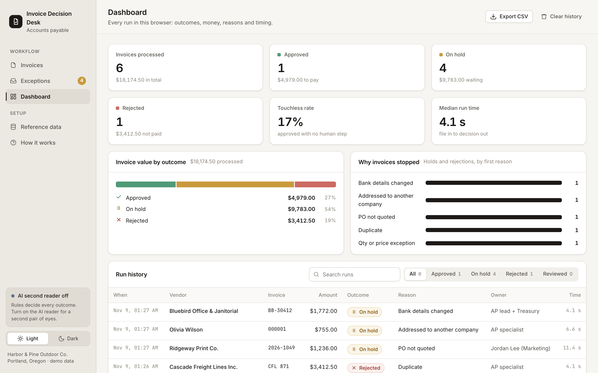
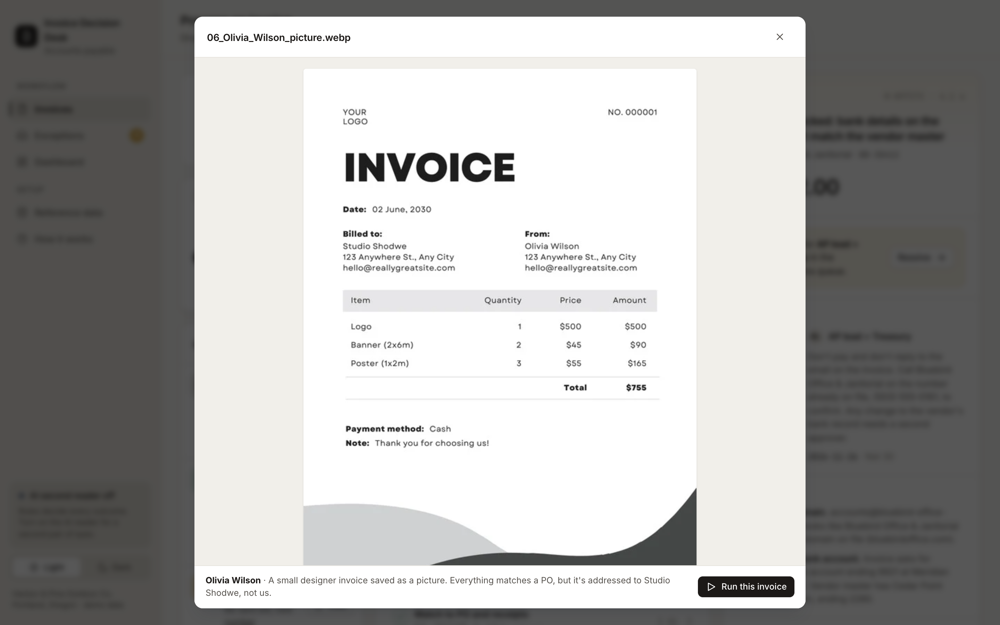
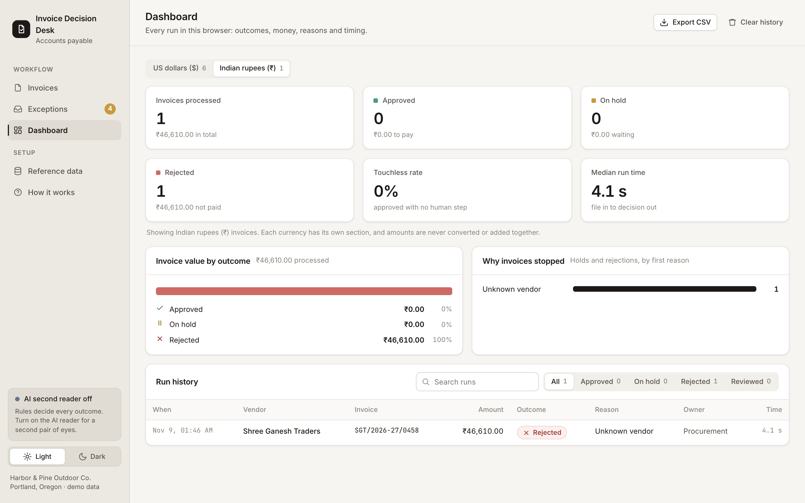

# Invoice Decision Desk

A web app that reads a vendor invoice and decides whether it should be paid.

Upload an invoice as a PDF or an image. The app reads it, checks it against the company's vendor list, purchase orders, goods receipts and payment history, and returns **approve**, **hold** or **reject**. Every decision shows the reasons, who should act next, and where each number came from on the document.

The company and its data are made up: Harbor & Pine Outdoor Co., with its own vendors, purchase orders, receipts and past payments.

Try It : [https://invoicedecisiondesk.vercel.app/](https://invoicedecisiondesk.vercel.app/) 




## The problem it solves

Someone in accounts payable opens every invoice and checks the same things by hand. Is the vendor real and active? Which purchase order is this for? Did the goods arrive? Was it paid already? Is the bank account the one on file?

It is slow, and the costly mistakes are easy to miss: paying a bill twice, paying a fraudster's bank account, or paying for goods that never came. This app does those checks automatically and leaves the uncertain cases to a person.

## How it works

Every invoice goes through ten stages, shown live on screen.

| # | Stage | What happens |
|---|---|---|
| 1 | Receive file | Accepts PDF, PNG, JPEG or WebP and fingerprints it, so an identical file is recognised. |
| 2 | Read the document | Reads a text PDF with pdf.js. Scans and images are read with Tesseract OCR. |
| 3 | Extract fields | Finds the invoice number, date, PO, totals, tax, bank details, sender, buyer, currency and line items, and keeps the line each value came from. |
| 4 | Second reading by AI | Optional. A language model reads the invoice separately and the two readings are compared. |
| 5 | Check the invoice | Required fields, arithmetic, a sensible date, and whether it is addressed to the right company. |
| 6 | Vendor and bank | Is the sender an active vendor? Does the bank account match the one on file? Is the email domain a lookalike? |
| 7 | Duplicate check | Compares with every invoice already paid or entered, after normalising the number, so `INV-0871` and `CFL 871` both match `871`. |
| 8 | Match to PO and receipt | Checks each line for price, quantity ordered and quantity received. |
| 9 | Decide | Applies 13 rules in a fixed order. The first rule that matches sets the outcome. |
| 10 | Record and route | Writes the record and sends held invoices to the review queue. |

The decision always comes from rules, so the same invoice gets the same answer every time. Fraud and duplicate checks run before purchase-order matching, because a perfect match says nothing about where the money is going.

Held invoices go to the **Exceptions** queue, where a person resolves them with actions that fit the reason. For example, a changed bank account can only be released with a note recording a call to the phone number already on file. The **Dashboard** shows outcomes, value, reasons for holds and rejections, and a searchable history that can be exported as CSV.

## Sample invoices

Six samples are built in. Five are edge cases that a simple process would get wrong.

| # | Invoice | What makes it tricky | Decision |
|---|---|---|---|
| 1 | Northwind Packaging | One price 0.95% over the PO and an $85 freight line, both within policy. | Approved |
| 2 | Summit Textile | Bills more than was ordered, and goods that have not arrived. | Hold, $4,836 payable now and $1,184 disputed |
| 3 | Cascade Freight | A bill already paid, sent again with the number reformatted. | Rejected as a duplicate |
| 4 | Bluebird Office | Matches its PO exactly, but asks for payment to a new bank account from a lookalike domain. | Hold, payment blocked |
| 5 | Ridgeway Print | A scanned image with no PO number printed. | Hold until the PO is confirmed |
| 6 | Olivia Wilson | A template invoice saved as a small image, addressed to another company. | Hold, wrong buyer |



## Problems I ran into

**Reading an image invoice.** A template invoice saved as a small image returned almost nothing at first.

- The image was too small for OCR, so small images are now enlarged before reading.
- The large stylised "INVOICE" heading was skipped. If no "invoice" word is found, the page is read a second time in a mode for scattered text.
- The number was printed as "NO. 000001" and the total as "$755." with a full stop. Both are now accepted.
- "Billed to" and "From" sat side by side, so sender and buyer got mixed up. Lines are now split into columns at wide gaps between words.
- A price was misread as "sus" instead of "$45". When a row sits between two good rows, its price is worked out from amount and quantity and flagged for a person.

**Invoices addressed to someone else.** Nothing checked who an invoice was for, so I added a "Billed to" check and a rule that holds these invoices.

**Hosting and the AI reader.** The first version ran as a Claude artifact, where every visitor's AI call used my own allowance and needed a Claude login. I moved it to a static site on Vercel with one small serverless function. With Gemini, a valid key still showed "the AI service is busy". The likely cause was a deprecated default model, and the app was hiding Google's real error. I changed the model, show the provider's actual message, and retry once on the server. The AI reader is now optional, supports Gemini, OpenAI, Grok and Claude, and loads the model list from the provider.

**Keeping keys private.** A visitor's own key goes straight from their browser to the provider. It is never sent to this site's server and never stored.

**Currencies.** Adding dollars and rupees together is wrong, and converting everything into one currency hid the amount printed on the invoice. Each invoice keeps its own currency, and the dashboard has a separate section for each currency.

**Smaller fixes.** Characters such as "·" showed as "·" until the page declared UTF-8. Samples failed to load without a web server, so they are now embedded in the page. Clicking a sample used to run it immediately, so it now opens a preview with a separate Run button.

## Screens

| | |
|---|---|
|  |  |
| **Exceptions.** Held invoices with the actions for each reason. | **Dashboard.** Outcomes, value, reasons and history. |
|  |  |
| **Preview.** A sample opens for inspection before it runs. | **Currencies.** Each currency has its own dashboard section. |

## Deploy on Vercel

1. Import this repository in Vercel.
2. Keep the default settings. `vercel.json` tells Vercel to serve the `site` folder, and `api/read.js` becomes the `/api/read` function.
3. Deploy.

To enable the AI reader, add an environment variable `GEMINI_API_KEY` in the project settings and redeploy. The key stays on the server and is used by the `/api/read` function (`src/api/read.js`).

How the AI reader behaves once deployed:

- Visitors just switch it on. It uses your Gemini key, with nothing to enter.
- If your Gemini limit is reached, the invoice continues on the rules, and the visitor is told the built-in reader has reached its limit. Only then does the option to enter their own API key appear (Gemini, OpenAI, Grok or Claude).
- If `GEMINI_API_KEY` is not set, the own-key option is shown from the start.
- Either way, the rules make every decision.

## Run locally

```bash
python3 -m http.server 8765 --directory site
```

Open <http://localhost:8765>. To try the built-in Gemini reader locally, run `./run_local.sh`, which asks for a key without showing it and serves the app on <http://localhost:8767>.

After changing anything in `src/` or `samples/`, rebuild with:

```bash
python3 tools/build.py
```

## Tests

```bash
node tools/test_engine.js           # the six sample decisions, plus a duplicate re-run
node tools/test_person_invoice.js   # the image invoice that exposed the reader problems
node tools/test_real_formats.js     # an Indian GST invoice, other layouts, non-invoices
node tools/test_ai.js               # the four AI providers, with simulated replies
```

No network connection or API key is needed.

## Project structure

```
src/                 source code
  engine.js          extraction, checks and decision rules
  data.js            vendors, purchase orders, receipts, ledger, policy
  ai.js              optional AI second reader
  ui.js              screens, live run, review queue, dashboard
  app.html           layout and styles
  api/read.js        serverless function for the built-in Gemini reader
samples/             the six sample invoices
site/                built app, the folder Vercel serves
api/read.js          Vercel entry point for the AI reader function
vercel.json          tells Vercel to serve site/
tools/               build script, tests, sample generator, local server
test-inputs/         extra invoices used for testing
docs/screenshots/    images for this README
```

Built with plain HTML, CSS and JavaScript, [pdf.js](https://mozilla.github.io/pdf.js/) and [Tesseract.js](https://tesseract.projectnaptha.com/).

## Limitations

- Vendors, purchase orders and receipts are fixed demo data. Nothing is actually posted or paid.
- One invoice per file, and only the first three pages are read.
- Faint, rotated or handwritten scans come out as unreadable.
- History is saved in each visitor's browser, not a shared database.
- Drafted messages to vendors are left for a person to send.
